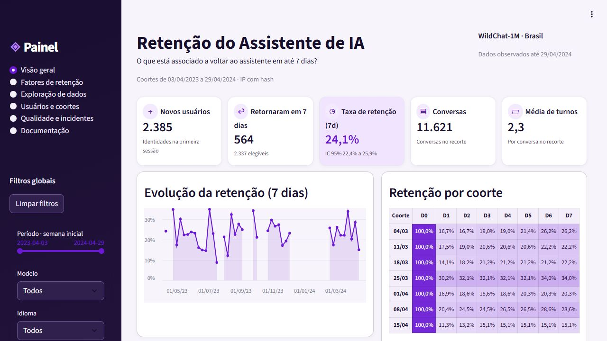

# Retenção em Assistentes de IA

Pipeline em Python e painel em Streamlit para analisar o retorno em até sete dias no recorte brasileiro do WildChat-1M. A base analítica em SQLite alimenta as coortes, os filtros e as estimativas dos fatores associados ao retorno.

No recorte analisado, 564 de 2.337 identidades elegíveis voltaram em até sete dias (24,1%). A análise usa IP com hash como aproximação de identidade. Os efeitos estimados descrevem associações. [Veja os resultados](RESULTADOS.md).

[Acesse a demonstração do painel](https://retencao.ox.opalstacked.com/).



## Como rodar

Com Python 3.13, execute na raiz do repositório:

```bash
python -m pip install -r requirements.txt
python run.py
```

Abra o [painel local](http://localhost:8501). A primeira execução baixa cerca de 3,36 GB de Parquet, filtra as conversas brasileiras e gera a base SQLite. Para atualizar a base na execução direta com Python, rode `python run.py --rebuild`. Para rodar os testes, use `python -m unittest -v`.

Consulte [as decisões de arquitetura e negócio](DECISOES.md) e [a investigação do incidente de retenção](INCIDENTE.md). Os dados vêm do Allen Institute for AI e estão sob a licença ODC-BY. [Fonte dos dados](https://huggingface.co/datasets/allenai/WildChat-1M)
